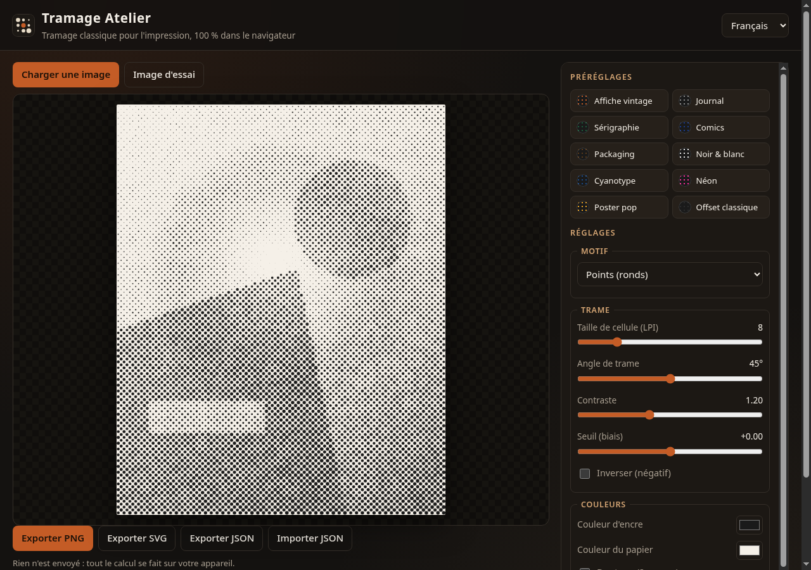
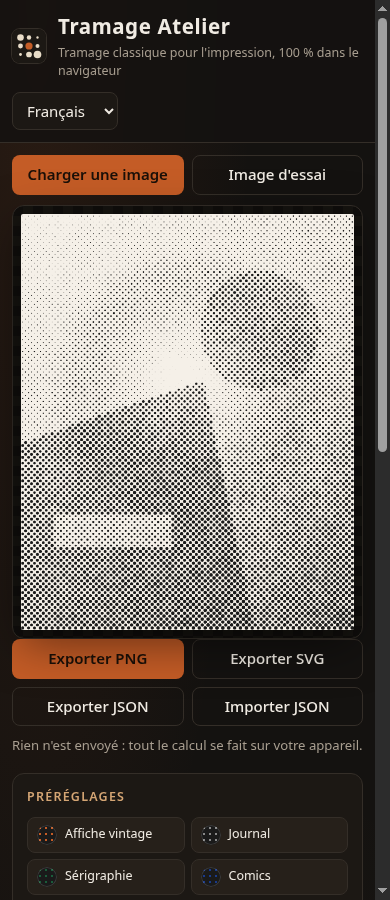

# Tramage Atelier

Générateur de **tramage** (halftone) classique pour graphistes print / affiche / packaging.  
Tout tourne dans le navigateur : aucune image n’est envoyée sur un serveur.

**Démo :** [https://salimadour31-boop.github.io/tramage-atelier/](https://salimadour31-boop.github.io/tramage-atelier/)





---

## C’est quoi ?

Tu charges une image (PNG, JPEG, WebP), tu choisis un motif de trame (points, carrés, lignes, losanges), tu règles la taille de cellule, l’angle, le contraste, les couleurs d’encre et de papier — et tu exportes.

Le moteur utilise un **criblage AM** (amplitude modulée) : la luminance de chaque cellule détermine la taille de la forme, comme une trame offset traditionnelle. Tu peux aussi activer un **duotone** (deuxième encre).

## Fonctionnalités

- Glisser-déposer ou sélecteur de fichier
- Motifs : points ronds, carrés, lignes (horizontales ou selon l’angle), losanges
- Contrôles : taille de cellule (ressenti LPI), angle 0–90°, contraste, seuil, inversion, encre + papier, duotone
- 10 préréglages artistiques : Affiche vintage, Journal, Sérigraphie, Comics, Packaging, Noir & blanc, Cyanotype, Néon, Poster pop, Offset classique
- Export **PNG** (pleine résolution), **SVG** (formes vectorielles pour Illustrator), **JSON** des réglages
- Image d’essai générée procéduralement si rien n’est chargé
- Interface FR / EN / Taqbaylit (kabyle)
- 100 % HTML / CSS / JS — pas de build, pas de framework

## Utilisation

1. Ouvre `index.html` en local, ou la [démo Pages](https://salimadour31-boop.github.io/tramage-atelier/).
2. Charge une image ou garde l’image d’essai.
3. Choisis un préréglage ou peaufine les curseurs.
4. Exporte en PNG pour le web / maquette, ou en SVG pour Illustrator.

Astuce SVG : pour les trames très fines, l’export limite le nombre de cellules afin de garder un fichier raisonnable.

## Structure

```
tramage-atelier/
  index.html
  styles.css
  app.js
  tramage.js   ← algorithme de criblage
  i18n.js
  LICENSE
  README.md
```

## Licence

MIT — © 2026 Amirouche Amwanes / [salimadour31-boop](https://github.com/salimadour31-boop)

---

## English (short)

**Tramage Atelier** is a free, browser-only classic AM halftone generator for print designers. Load an image, pick dots / squares / lines / diamonds, tune cell size, angle, contrast, ink & paper (optional duotone), then export PNG, vector SVG, or settings JSON. UI in French, English and Taqbaylit (Kabyle). No uploads, no API keys.
